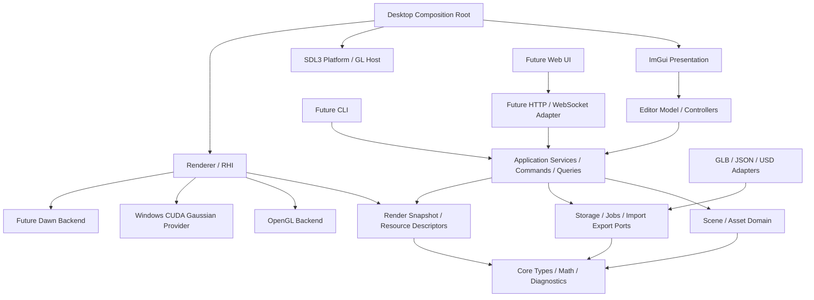
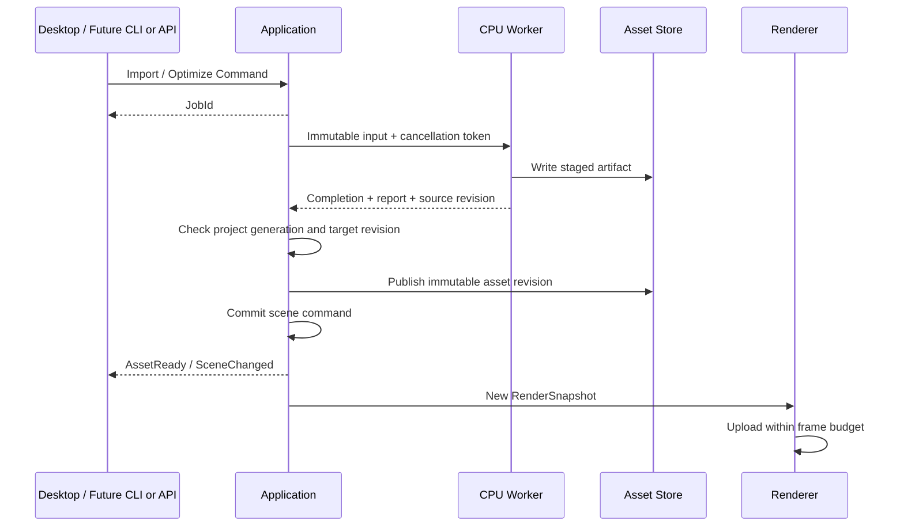

# WorldForge 软件架构

日期：2026-09-21。状态：按 Windows 优先重新分期的架构基线，P0 框架与 P1.1 静态 Mesh 导入已有可运行切片，完整架构尚未实现。当前范围以 ROADMAP、PHASE_1、ADR 0004 为准；本文后续接口不代表首期需要全部实现。

## 2026-09-21 规划覆盖说明

本文后续部分保留早期长期架构草案；其中旧 P0–P7 是历史阶段，不能与新功能优先级混用。现行实施按版本表：v0.1 Windows Hybrid、v0.2 有界 Asset Factory/真实采集/最小资产 CLI、v0.3 GPU 优化与 Windows/Linux 实测。Linux 核心编译提前；单资产 USD 与完整 scene/Isaac adapter 分别验收。旧“多平台统一后置”“资产优化仅按需”的排期由 ROADMAP/ADR 0004 覆盖，接口草案本身不构成实现承诺。

## 已落地的 P1.1 切片

当前真实 target 为 wf_domain、wf_import、wf_editor、wf_renderer、wf_platform、wf_imgui 和 worldforge-studio。wf_import 暂合并内存 GLB 适配器与单任务服务；Renderer 已消费只读 RenderScene，不依赖 EditorState。业务 ID 仍为会话内整数，未实现持久 UUID、Command/Undo、项目锁或保存。预览直接使用 GLM OpenGL 投影和基础漫反射，尚未实现下文的统一深度/HDR/PBR 契约。

文件选择 → UTF-8 读取 → 工作线程解析 → 主线程检查代次/上传 → 发布包装根；Mesh/节点不可变共享，源矩阵与实例保留。具体所有权、支持限制及验证见 [P1.1 实现说明](learning/0002-mesh-import.md)。下文描述目标架构，不应把接口草案视为已交付能力。

## 1. 设计输入与关键决策

本设计保留开源参考讨论中的 Core/UI/平台/渲染分离原则，实施顺序按最新要求调整：**Windows 桌面框架 → Mesh → 混合渲染 → 世界资产闭环与首发**。后续按 v0.2 补资产加工/真实采集/最小 CLI，v0.3 交付实测 CUDA 优化和 Windows/Linux 证据；完整 Agent、插件、macOS/Web 后置。

| 决策 | 当前实现与后续边界 |
| --- | --- |
| 桌面 | Windows 11 x64、C++20/MSVC/CMake、SDL3、ImGui docking |
| 渲染 | Windows OpenGL 4.5 / GLSL 450；最小资源接口，不先实现完整多后端引擎 |
| Gaussian | Windows/NVIDIA CUDA provider 优先；Linux/NVIDIA 后续实测；非 CUDA/macOS 后置 |
| 业务复用 | 目标 GUI 通过 Service/Command；未来 CLI/HTTP 复用，不要求首期完成协议注册 |
| 场景 | 自有轻量模型，Visual/Collision/Semantic 分离；项目包先闭环，USD adapter 后续 |
| 扩展 | 源码 addons、Dawn/WebGPU、Web UI 和多平台均不作为首发前提 |

Windows 以外的平台不声明已支持。SDL3/ImGui 的可移植性有助于保留边界，但不代替各平台的真实实现与运行验证。[SDL3](https://wiki.libsdl.org/SDL3/FrontPage)、[ImGui](https://github.com/ocornut/imgui/blob/docking/docs/BACKENDS.md)

后续 Mac 移植需独立处理图形后端及非 CUDA Gaussian；Apple 的 OpenGL 4.1 接口已弃用，不应假定当前 GL 4.5 后端能直接运行。[Apple 文档](https://developer.apple.com/documentation/appkit/nsopenglprofileversion4_1core)。Dawn 是后续统一后端候选，不是首期依赖。[Dawn](https://github.com/google/dawn/blob/main/README.md)

最新优先级见 [ADR 0004](decisions/0004-interview-delivery-priorities.md)，首期验收见 [PHASE_1](PHASE_1.md)。

## 2. 分层与依赖

下图是长期依赖边界，不是首期模块建设清单。CLI、HTTP、Dawn 为后续模块。Adapter 实现内层端口，内层不反向包含 Adapter 头文件。

### 模块职责

| CMake target / 逻辑模块 | 拥有的内容 | 禁止依赖 |
| --- | --- | --- |
| `wf_core` | 强类型 ID、数学约定、Result、Diagnostic、基础值类型 | SDL、ImGui、GL、CUDA、USD |
| `wf_domain` | Scene、Entity、CPU 资产、材质、LOD、Gaussian 数据、业务校验 | 窗口、图形 API、文件格式 SDK |
| `wf_application` | 世界与资产服务、命令分发、查询、任务协调、存储/导入导出端口 | ImGui、SDL、具体 IO / GPU 后端 |
| `wf_io` | tinygltf、JSON、文件存储、meshoptimizer 的适配实现 | ImGui、SDL、GL |
| `wf_jobs` | 有界 CPU 工作队列、取消、进度和完成队列，实现 Application 端口 | UI、窗口、场景直接写入 |
| `wf_render_contracts` | RenderSnapshot、Camera、资源描述符、能力和帧统计 | SDL、ImGui、原生 GPU 类型 |
| `wf_renderer` | 可见性、Mesh/Debug/Gaussian pass 编排、GPU 资源缓存 | Editor、Application 可变状态、SDL |
| `wf_rhi_gl` | GL 4.5 设备、缓冲、纹理、着色器、管线和同步 | Editor、业务命令 |
| `wf_platform_sdl` | 窗口、事件、文件选择、DPI、GL 上下文宿主 | Domain 业务 |
| `wf_editor` | 选择、相机、工具状态、面板 ViewModel、控制器 | ImGui、原生图形类型 |
| `wf_ui_imgui` | 面板展示、输入转换、ImGui 平台/图形桥接 | 直接修改 Scene、调用优化算法 |
| `wf_studio` / 后续 `wf_cli` | 组合根：创建依赖、注入实现、管理退出顺序；首期仅 Studio | 不承载资产算法 |

`wf_application` 可生成 `wf_render_contracts` 的快照，但不调用图形设备。`wf_renderer` 消费快照与只读资产接口。UI 的视口控制通过 `IViewportService`，其桌面实现连接 Renderer。图中未来模块只表示边界，不要求现在创建空实现。

## 3. 数据模型与所有权

### 3.1 场景与资产

- `SceneId`、`EntityId`、`AssetId` 使用持久 UUID；不得用数组下标或内存地址充当持久 ID。
- `SceneDocument` 拥有实体表、父子关系、场景 revision。Entity 保存 name、parent、local transform、visible 和可选组件。父子关系禁止环；删除父节点默认删除子树，一次命令可撤销。
- `Transform` 保存局部仿射矩阵，支持 GLB 的 matrix 与 TRS。可分解时 Inspector 提供 TRS 编辑；含 shear 等无法无损分解时保留矩阵并禁用 TRS 编辑，不能静默丢失变换。
- `VisualComponent` 持有表示引用列表：Mesh 或 Gaussian、各自局部变换和显示开关。允许一个 Entity 同时关联多种表示，并由显示模式决定启用项。
- `CollisionComponent` 引用独立的 primitive/convex/triangle proxy；仅关联、检查和显示不等于已经执行物理仿真。
- `SemanticComponent` 保存类别和键值属性，不从文件名自动断言质量或物理真实性。
- `AssetCatalog` 拥有资产描述、来源与 revision；`AssetStore` 拥有不可变 CPU payload。实例引用共享资产，实体变换不修改源几何。
- Mesh 包含 primitives、顶点属性、索引、材质引用和各级 LOD。新 LOD 是新资产 revision；原始数据可用于回退和对照。
- Gaussian CPU payload 保存位置、协方差的尺度/旋转表示、opacity、SH 系数及 degree。导入器把来源中的 log-scale/logit 等编码转换为运行时表示，并记录来源约定；普通点云 PLY 不自动当作 3DGS。

GLB 导入产生“资产集合 + 节点实例树”。同一 mesh 被多个 node 引用时共享几何，保留节点变换。材质、纹理和 sampler 引用都属于资产，不由面板持有。

### 3.2 三种独立状态

| 状态 | 所有者 | 持久化与生命周期 |
| --- | --- | --- |
| 世界与资产事实 | Application / Domain | 存入项目；业务命令是唯一写入口 |
| 当前用户的编辑状态 | EditorSession | 选择、悬停、相机、对比视图、布局；可单独保存本地偏好，不修改共享 Scene revision |
| 渲染派生状态 | Renderer | 资源缓存、可见列表、排序、帧缓冲；不写进业务文档，可销毁重建 |

CPU payload 用只读共享所有权跨任务/帧传递；GPU 资源仅由设备拥有。快照引用准确的 `(AssetId, revision)`，不能在渲染期间读取被后台改写的向量。

### 3.3 数学与颜色约定

内部采用右手坐标系、Y-up、米、弧度、列向量；局部矩阵 `T * R * S`，世界矩阵 `parentWorld * local`，相机朝局部 -Z。DTO 四元数顺序固定为 `[x,y,z,w]`，矩阵按列优先序列化。

渲染契约的投影深度统一为 `[0,1]`，当前 GL 后端在顶点阶段映射为 `[-1,1]` clip Z，避免图形深度约定进入业务数据。混合算法另用正值线性视距 `-viewZ`，不比较未经转换的硬件深度。屏幕 UV 以左上为原点，由后端桥接 GL 的纹理朝向。

颜色计算在线性空间；base color / emissive 纹理按 sRGB 解码，法线/粗糙度/金属度是线性数据，最后一次色调映射与显示编码。USD 导出显式写入单位和 up-axis。不能假定外部 Gaussian 已经与 Mesh 对齐，需保留导入根变换供用户校准。

## 4. Service、Command 与 DTO

### 4.1 公共语义

下列是语义接口设计，不是已发布的 ABI。首期只实现桌面闭环使用的 C++ 值类型与调用；命令 envelope、公开 DTO schema、网络序列化和跨进程能力在 P4/P7 落实。

| 接口 | 最小职责 |
| --- | --- |
| `IWorldService` | 获取场景快照、实体与资产关联查询 |
| `IAssetService` | 资产描述/报告查询、检查与优化任务提交 |
| `ICommandService` | 分发场景修改、撤销/重做，返回 revision 或 JobId |
| `IJobService` | 查询任务、请求取消、订阅进度/完成事件 |
| `IProjectService` | 创建、保存、打开项目；作为事务处理 |
| `IViewportService` | 视口相机、尺寸、显示模式、渲染结果和选取请求；不暴露 GPU 对象 |

命令集合包含 CreateEntity、DeleteEntity、SetTransform、SetVisibility、AttachRepresentation、ImportAsset、ValidateAsset、OptimizeAsset、GenerateLOD、ExportScene。查询和相机悬停不走可撤销命令历史。

`CommandEnvelope` 含 `schemaVersion`、`requestId`、`sceneId`、`expectedRevision`、command type 与 payload。只读/纯资产任务不强制场景 revision；结果附着场景时重新校验目标。返回值为 `Applied(newRevision)`、`Accepted(jobId)` 或结构化错误。

错误至少区分 InvalidArgument、NotFound、Unsupported、Conflict、Cancelled、IOFailure、ResourceExhausted。Diagnostic 附 asset/entity/primitive 定位、severity 和 message；不把日志文本当机器协议。

DTO 包括 AssetDTO、EntityDTO、SceneDTO、ValidationReport、JobDTO、BenchmarkReport、CapabilitiesDTO。大几何不塞进 JSON，通过 blob 引用获取。Capabilities 必须区分 build support、runtime availability 和不可用原因，例如 CUDA 编译存在但当前 GPU 不匹配。

### 4.2 撤销与一致性

命令不会天然可撤销：仅已提交的场景编辑保存 before/after 或被删除子树；拖动过程为本地预览，结束提交一条变换命令。导入/优化的“附着结果”可以撤销，磁盘输出和外部训练不反向撤销。导出是副作用任务，不进入撤销栈。

v0.1 一个场景一个串行写入者；远程阶段仍由该写入者顺序处理命令。`expectedRevision` 不符返回 Conflict，客户端刷新重试，不覆盖他人新状态。远程请求使用 requestId 去重，未来服务端持久化收据；不承诺多用户协同编辑或 CRDT。

项目保存阶段的 Studio 将使用项目独占锁避免多个实例同时写入。跨进程 requestId、幂等收据与 CLI 重试语义推迟到 P4；不为未来协议阻塞桌面编辑与保存。

### 4.3 后期 CLI 与 Addons

v0.2 先实现最小资产入口，后续扩展独立 `worldforge` CLI，复用当前服务且不链接 UI/GPU 依赖。JSON、schema、退出码、项目锁/收据等详细候选契约保留于 [CLI_SPEC](CLI_SPEC.md)；它们不是 Windows 首发验收项。

首期不要求完整 CommandRegistry/AssetProcessorRegistry；用明确的服务/命令入口避免算法写进面板即可。P4 再统一命令发现与 schema，P5 将这些边界开放给源码 addons。

P5 的 addon SDK 使用显式 CMake 集成，校验依赖/API 版本，区分 headless commands/processors 与 desktop panels；任务结束后才能注销。扩展通过服务修改业务，不持有可变 Scene 或原生 GPU handle。Windows 先验收，多平台随 P6 扩展。参见 [ADR 0002](decisions/0002-addons-and-agent-cli.md)及其后续覆盖记录 ADR 0003。

## 5. 数据流、线程与失败恢复

- 桌面主线程负责 SDL、ImGui、场景提交、GL 调用及 present。CPU 工作者只处理不可变输入，不创建 GL 对象，也不直接写 Scene。
- 首版工作池默认 2 个 CPU 工作者、最多 32 个等待任务；队列满返回 ResourceExhausted，UI 可以重试。长任务报告阶段和进度，meshoptimizer 等不可中断调用结束后再观察取消，不承诺瞬时取消。
- 完成队列每帧排空并检查 project generation、目标实体存在性和输入 asset revision。关闭项目或改变源资产后，过期结果不自动附着；产物可保留为未使用缓存。
- GPU 上传按帧限额处理，视口显示 loading 状态。GL 单次驱动调用仍可能造成停顿；不能把“后台解析”宣传为所有上传无卡顿。
- Renderer 内部状态为 CPUReady → UploadQueued → GPUReady / Failed。上传失败不回滚已经有效的 CPU 资产，允许继续检查、保存和重试。
- 应用关闭顺序：停止接收命令 → 取消并等待工作者 → 清空完成回调 → 等待 GPU 工作 → 释放 CUDA 注册与 GPU/UI 资源 → 销毁上下文 → 销毁窗口/SDL。

## 6. 渲染边界与 Hybrid Pipeline

### 6.1 最小 RHI

`IRenderDevice` 提供资源创建/销毁、上传、pass 编码、draw、submit、完成票据和 capability 查询。资源使用带 generation 的 BufferHandle、TextureHandle、PipelineHandle；只允许后端访问 GLuint、CUDA pointer 或将来的 Dawn 对象。

首期实现 Mesh raster 与 CUDA/GL interop 所需能力；compute/storage 等接口按实际使用增加，不预先封装完整 GPU API。管线描述包含 shader key、顶点布局、绑定布局、深度和混合状态。GLSL 450 与未来 WGSL 分开实现，共享参数契约，不承诺自动转换。

Renderer 使用有明确输入输出的固定 pass 列表，不先造通用 RenderGraph 编译器。`RenderSnapshot` 含 camera、world matrices、bounds、asset revision、material/LOD 引用、visual flags 和 scene revision，不含窗口或 ImGui 类型。

SDL GL Host 在组合根创建/current/swap 上下文；GL device 通过注入的函数加载器初始化。Renderer 不调用 SDL。ImGui texture bridge 仅在 UI 后端把 RenderOutputToken 解析为原生纹理，业务面板不接触 GLuint；未来 Web 的视口 token 是浏览器本地状态，不跨网络传 GPU handle。

### 6.2 帧流程

1. 更新相机和场景快照，计算世界变换、法线矩阵、剔除和 LOD。
2. 上传待用资源；缺失资源显示包围盒与错误标记。
3. MeshPass 输出线性 HDR color、硬件 depth、正线性 view depth 和实体 ID。
4. GaussianPass 使用同一相机和 Mesh 线性深度，输出 premultiplied color 与透射率。
5. Composite：`C = C_gaussian + T_gaussian * C_mesh`，然后调试覆盖、色调映射和 UI。

Gaussian 深度用投影中心近似；每像素丢弃位于不透明 Mesh 后方的贡献。不能仅把整张 Gaussian 图盖在 Mesh 上。Gaussian 不提供可靠物理表面，也不写入一份被误称为真实表面的深度。半透明 Mesh、统一动态重光照及精确体积交界不属于初版。

### 6.3 首期 CUDA 与后续可移植路径

- **Portable Gaussian（P6 候选，首期不实现）**：CPU 投影/剔除/稳定深度排序，GL 4.1 instanced quad 光栅化，fragment shader 计算椭圆权重，采样 Mesh 线性深度并混合。不使用 GL compute/SSBO；每个 splat 的投影参数和颜色经 instance buffer 上传。后续需用各平台实测选择此路径或新的后端，大场景性能单独披露。
- **CUDA Gaussian（P2 首先实现）**：同样的资产和相机契约，使用 tile binning、排序与前向合成；由专用 CUDA/GL adapter 处理注册、map、unmap、同步和 resize。启用条件包括支持的 NVIDIA GPU、兼容运行时以及 GL/CUDA 对应同一设备，不只检测 Toolkit 是否安装。[CUDA GL interop](https://docs.nvidia.com/cuda/cuda-runtime-api/group__CUDART__OPENGL.html)
- 首期 CUDA 不可用时保留 Mesh 功能，Gaussian 明确显示 unavailable 及原因，不悄悄隐藏场景。portable provider 尚未交付时不存在自动回退；后续加入回退后也必须标明所选算法。
- 当前先验证 CUDA 正确性并保留优化前基线。后续 CPU/GL 与 CUDA 可能产生排序差异，分别测画质与速度，不通过减少 splat 数暗示算法等价提速。
- 后续 macOS/Web 必须提供独立于 CUDA 的显示路径；Dawn 或浏览器 WebGPU 是候选。此项属于 P6/P7，不阻塞 Windows 混合渲染。

GPU 资源删除在提交完成后执行。视口 resize、项目切换和 device/context loss 都使对应 GPU cache 失效；CPU 资产仍可重传。能力缺失时禁止把失败输出伪装为空场景。

未来 Portable 路径按远到近顺序执行 premultiplied alpha over，得到累计 color 与 alpha，透射率为 `1-alpha`；CUDA 路径可按近到远累积 color/transmittance。两者交付相同含义的合成输入。首版选取 Mesh 使用 ID buffer，Gaussian 以实体包围盒/显式代理选取并标明近似，不把透明贡献误称为精确表面命中。

## 7. 持久化与 USD 边界

项目目录包含 `worldforge.json`、`assets/source/`、`assets/derived/` 和可删除的 `cache/`。清单记录 formatVersion、sceneId、revision、实体和资产表；资产表含相对路径、内容 hash、来源、import settings、工具版本、派生参数及报告引用。UI 布局与个人相机另存，不混入发布场景。

当前保存只需保证资产与清单提交一致性；P4 加入项目写命令收据以支持 CLI 响应丢失后的去重，P5 再加入 addon 元数据兼容。版本字段从首期保留，不提前实现未来收据与插件设施。

导入先复制/整理到项目资产区；默认禁止项目外相对路径、绝对路径和 `..` 越界引用。重定位只依赖项目目录。文件名用 ID，显示名独立，避免大小写文件系统差异影响引用。纹理随 GLB 或规范资产包一起保存。

保存采用“先写唯一名称的不可变资产，再写临时 manifest，最后替换 manifest”的提交顺序；保留上一个有效清单。失败不切换活动清单；未引用产物稍后显式清理。打开项目先完整解析/验证再切换当前状态。缺失资产保留 Entity 并给出诊断，未来格式版本拒绝覆盖保存。

USD 用独立 `wf_io_usd` 可选 target：Entity→Xform，Mesh→Mesh，材质→基础 PreviewSurface，碰撞元数据→适配器支持的物理 schema，单位/up-axis 显式设置。不在 Core 中存 UsdStage 或 SdfPath。

借鉴 OpenUSD 的引用、实例和表示分离思想，但 v0.1 不实现 layer composition、variants 或 USD 无损往返。JSON 是编辑器工程清单，不是替代 USD 的通用交换标准；USD 阶段只导出已声明的子集。Gaussian 外部引用和元数据不等于下游原生可渲染 Gaussian。[OpenUSD 介绍](https://openusd.org/release/intro.html)

## 8. Web 接入契约

本节为 P7 后续设计。现在只保持服务与数据的清晰边界；公开 DTO/序列化契约在 P4/P7 落实，网络服务器、Web UI 与 Dawn 不列入桌面首期依赖。未来 Web 第一版包含 Asset Browser、Hierarchy、Inspector、3D Viewport、任务提交与结果查看。

| 未来 HTTP 接口 | 共享语义 |
| --- | --- |
| `GET /api/v1/capabilities` | 可用格式、任务类型、渲染/计算能力与限制 |
| `GET /api/v1/scenes/{id}` | SceneDTO + revision，断线后可全量同步 |
| `POST /api/v1/scenes/{id}/commands` | CommandEnvelope；同步成功或异步 JobId |
| `POST /api/v1/assets/uploads` | 上传内容获得 blob ID；不能传服务器任意文件路径 |
| `GET /api/v1/assets/{id}` | AssetDTO 与可下载表示引用 |
| `GET /api/v1/blobs/{id}` | 大资源二进制传输，支持 Range / 内容 hash 校验 |
| `GET /api/v1/jobs/{id}`、`POST /api/v1/jobs/{id}/cancel` | 任务查询和尽力取消 |
| `WS /api/v1/events` | SceneChanged、AssetReady、JobProgress、JobFinished |

协议错误映射：参数错误 400、不存在 404、revision 冲突 409、请求过大 413、能力不支持 422、队列满 429、执行失败 500；任务已接受返回 202。事件带 sequence、requestId 和相关 revision；重连发现缺口时重新拉快照和任务状态。HTTP POST 重试使用同一 requestId，由服务端收据去重。

Web 前端维护展示模型和相机，业务事实以服务器为准；编辑只发送语义命令。几何使用 GLB/明确版本的 Gaussian payload 与 manifest 传递。重建、LOD、训练和 CUDA 在后端执行。浏览器需独立检测 WebGPU 能力，不支持时提供资产/任务面板及明确的视口不可用提示，不返回假渲染。

C++ 与 TS 共享 JSON 契约测试样例，不共享内部 struct 二进制布局。将来服务器默认 loopback；对外部署前必须有鉴权、项目级访问控制、上传/任务配额和取消管理。传输适配器负责安全边界，Domain 不接受任意路径或命令行执行请求。多租户、协同编辑、云调度和视频流式远程渲染不在本轮范围。

## 9. 构建与验证

源码按 core/domain/application/io/jobs/render/platform/editor/ui 分区，当前入口只有 `apps/studio/`。按功能逐步创建 target，不先生成所有规划模块空壳。

C++20、CMake target-based 配置、FetchContent 固定提交/hash；GLAD 使用 GL 4.5，JSON 使用 nlohmann/json、测试使用 Catch2。准确依赖 pin 随首次可编译工程提交记录。

当前开关：`WF_BUILD_STUDIO=ON`、`WF_BUILD_TESTS=ON`、`WF_ENABLE_GPU_TESTS=OFF`；CUDA 开关尚未实现；P2 增加 CUDA 构建配置及 NVIDIA 发布配置。关闭 CUDA 不影响 Mesh Studio。当前未实现 CLI/USD 构建目标，在 v0.2 按实际使用增加。

| 环境/能力 | 当前义务 | 后续义务 |
| --- | --- | --- |
| Windows 11 x64 / MSVC | Studio 构建、CPU 测试、实际图形会话、可分发包 | P4 CLI 与后续 addon |
| RTX 4070 Ti 12GB | P2/P3 CUDA 混合与实测性能，报告驱动/版本 | 优化案例与更多设备验证 |
| 无 CUDA Windows | 可启动 Mesh，Gaussian 不可用有诊断 | 如有需求再扩展 provider |
| Linux | 近期核心构建/CPU 验证；不阻塞 Windows 首发 | v0.2 无窗口资产、v0.3 NVIDIA 图形实测 |
| macOS | 不属于本轮承诺 | 独立后端/provider、构建、打包、真机验证 |
| CLI/Agent | 业务服务/命令分离 | v0.2 最小资产 CLI；完整 Agent 协议后置 |
| Web | 无首期运行义务 | P7 网络/浏览器工作流 |

首期测试：Domain 层级/变换/实例；导入合法性与诊断；任务取消/关闭项目后的结果；GPU resize/资源释放；Mesh/GS 前后/交叉遮挡；混合项目打包、搬移、重开和保存失败回滚。服务测试无需创建公开 CLI。

P0/P1 开始观测帧时、资源和上传；P2 增加 GPU pass/排序/合成计时。按真实瓶颈穿插优化，不单列一个阻挡主功能的性能阶段。固定验收场景与报告要求见 ROADMAP。

## 10. 实施顺序

1. P0 Windows 桌面框架：SDL3 + ImGui + GL 视口、输入、日志和相机。
2. P1 Mesh：GLB → 后台任务 → 资产/场景 → MeshPass → Inspector → 保存重开。
3. P2 Hybrid：Gaussian 导入与 CUDA、统一相机/深度、实际遮挡用例；不先实现 portable provider 或完整 Asset Factory。
4. P3 世界闭环/首发：对齐、组合、代理/语义关联、项目包搬移重开、Windows 发布包。
5. P4 主功能深化与 CLI/Agent：按需求完善 LOD/比较/USD/批处理，再开放稳定服务给 CLI。
6. P5 源码 addons；P6 多平台；P7 Web/常驻 Agent 服务。独立排期，不倒置为 Windows 前置条件。

## 11. 需求追踪与有效决策

| 当前要求 | 设计落点 | 完成证据 |
| --- | --- | --- |
| Windows 先发布 | 第 1、9、10 节，ADR 0003 | Windows 包和 PHASE_1 验收 |
| 尽早 Mesh 与混合渲染 | 第 3、5、6 节 | Mesh/GS 编辑、遮挡与固定场景 |
| 世界资产闭环 | 第 7 节、PHASE_1 | 完整资产包搬移重开，不依赖导入源 |
| 性能按需穿插 | 第 9 节、ROADMAP | 瓶颈复现、测量与对应修正 |
| CLI/Agent 较后期 | 第 4.3 节、CLI_SPEC | P4 协议和脚本，非首发门槛 |
| 多平台后做 | 第 6、9 节 | P6 各平台独立运行验证 |
| 保留插件/Web 演进 | 第 4.3、8 节 | P5/P7 实施时验收 |

ADR 0001/0002 是历史方案，排期与平台门槛被 [ADR 0003](decisions/0003-windows-world-first.md)覆盖。开源参考见 [REFERENCES](REFERENCES.md)。当前 P0/P1.1 的实现与验证记录见 DEVELOPMENT.md 及 P1.1 实现说明；本文其余架构能力仍待实现。
