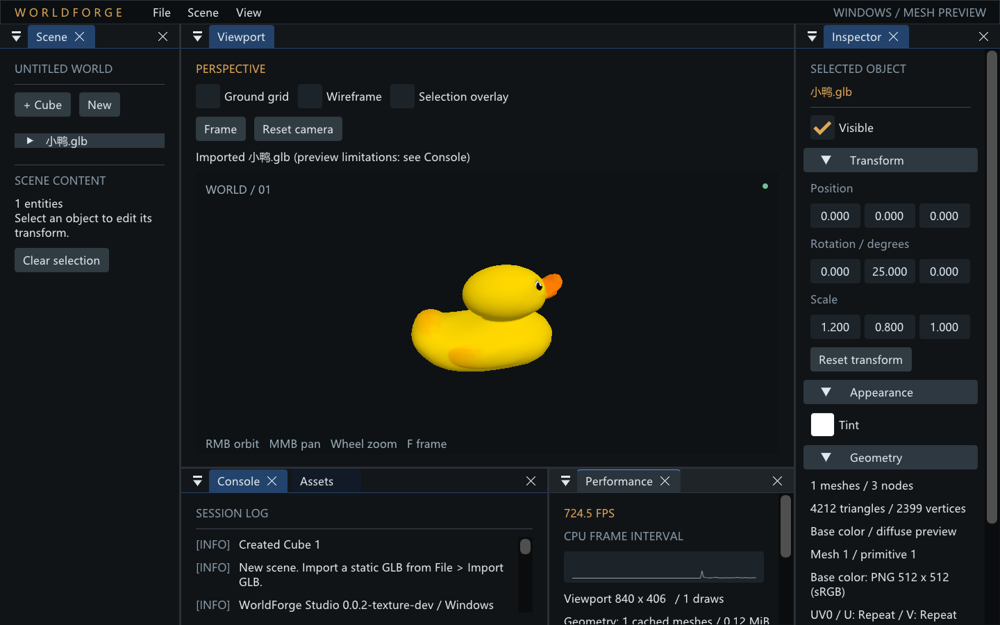

# 基础颜色贴图与选择显示验收

日期：2026-09-21。开发版本：0.0.2-texture-dev；不声明完整 0.0.3 已交付。
环境：Windows x64，VS Community 2026 / MSVC 19.51，SDK 10.0.26100.0，CMake 4.2.1，NVIDIA GeForce RTX 4070 Ti / OpenGL 4.5。

## 1. 构建与自动检查

- build/python/Scripts/python.exe tools/check_style.py：通过，固定 clang-format Google + cpplint；未降低规则。
- cmake --build --preset windows-release --parallel 8：通过。
- ctest --preset windows-release --output-on-failure：8/8 通过（最终一次 1.86 秒；仅测试执行时间）。
- git diff --check：提交前检查。
- 本机 GPU 测试必须打开 WF_ENABLE_GPU_TESTS；托管 CI 默认仅跑 CPU，不能用 CI 代替本机图形证据。

| 测试 | 本轮覆盖 |
| --- | --- |
| glb_importer | 保留索引/节点/矩阵；新增 PNG 多色型、共享图片/不同 sampler、默认采样、55 个拒绝用例、剩余图片预算 |
| import_service | busy、后台失败恢复、generation、退出 join 回归 |
| editor_state | 清选不删对象/变换、重选、独立显示快照、相机回归 |
| studio_gpu_smoke | Cube UI、缩放窗口、变换、相机和 GL 状态 |
| studio_mesh_smoke | 真实后台流程导入静态 fixture |
| selection_ui | 用 ImGui 真控件激活三个开关/Clear selection；Scene/Viewport Esc、Inspector 排除、文本输入、modal、busy 保护、空白点击、视口点击、无选择 F |
| texture_gpu | 四象限 UV、OPAQUE 忽略 alpha、纹理 sRGB、Tint/factor、无纹理路径、U/V repeat/clamp/mirror、linear mag、四种 mip min、线性光照 mip 平均 |
| mesh_gpu_smoke | 导入 Mesh 的像素、编辑、缩放、实例、隐藏、删除、重导入和 New Scene |

texture_gpu 还检查：
同图不同 sampler 仅一份 GPU 图片；隐藏保留；删一个实例保留；删最后引用/New Scene 回收；
在先成功暂存几何/图片后让后续图片失败，全部回滚；
制造真实 GL sampler 参数错误，回滚后不留下 GL 错误，旧场景继续渲染。

PNG 错误覆盖：签名、CRC（包括被忽略的辅助元数据）、截断、IEND 后数据、零/超尺寸、坏 zlib、超过解码分配预算的膨胀流；输出保持旧值。新增 UV、sampler、引用/范围、JPEG/data URI/纹理扩展拒绝用例。

没有实际耗尽驱动显存；GPU 失败通过受控无效图片数据与真实 GL 参数错误验证事务边界。192 MiB 解码预算是请求分配的上限，不是进程工作集测量值。

## 2. 真实 Duck 模型与安装包

使用 artifacts/models/小鸭.glb。来源、SHA256 和 SCEA Shared Source License 1.0 归属沿用 [上一轮 Duck 记录](2026-09-20-mesh-import.md)：Sony 2006 / Khronos glTF Sample Assets。源模型不进入仓库或开发包；下图是本程序的渲染结果。

安装后的 out/WorldForge-dev/worldforge-studio.exe 通过 --smoke-test 走实际后台读取/解析/上传/发布。36 帧内完成窗口变化、根变换和相机输入；success、viewportContent、resize、transform、cameraInput 均为 true。

- 4,212 triangles / 2,399 vertices，几何 127,312 bytes。
- PNG 512×512；CPU RGBA8 1,048,576 bytes。
- 1 cached mesh / 1 image / 1 sampler。
- GPU texture estimate 1,398,100 bytes（完整 mip 链，约 1.33 MiB）。
- selectionOverlay=false，仍保持选中；glError=0。
- 实测单次阶段统计：120484 file bytes / read 0.1278 ms / parse+decode 1.4787 ms / upload+publish 0.8827 ms / 127312 geometry bytes / 1048576 decoded image bytes。
- 阶段计时是 CPU 墙钟，不是 GPU timer；仅记录一次样例运行，不构成优化前后 benchmark。

本地完整机器报告：artifacts/duck_texture_packaged/report.json；截图原始 BMP 同目录。
Windows 程序 SHA256：7B8DFDCA80981C1C3844BFD0041A49CDF3EB364F018329263C30AC916535D940。
开发包：out/WorldForge-Windows-0.0.2-texture-dev.zip。包含运行库、文档和 LodePNG 等许可证，无新增正式 Release。

## 3. 已知限制和未验证项

原生文件选择框的完整操作仍未自动验收。2026-09-21 重试 computer-use 的 @oai/sky 初始化，返回：

    windows sandbox failed: helper_unknown_error: setup refresh had errors

这发生在工具初始化阶段，不是 WorldForge 的导入失败，也不是操作获批后被拒绝。没有用程序化导入冒充原生 UI 验收。用户此前截图证明正常选择/导入成功一次，取消、开框后退出等边界仍需人工补验。ImGui 的 busy 防误清选测试已通过，但它不等于 Windows 文件对话框实测。

没有验证其他 GPU 厂商、Linux、HDR/ICC 桌面色彩管理、完整 PNG/glTF 一致性与模糊测试。JPEG、完整 PBR、Scene 保存/重开、GS 和 CUDA 均未纳入本次实现。
