# P1.1 静态 Mesh 导入实现

日期：2026-09-20。开发版本：0.0.2。该增量实现静态 GLB 到可编辑根对象的链路；P1 的 PBR、贴图和保存重开仍未实现。

## 数据流与边界

```mermaid
flowchart LR
  Picker[Windows 文件选择] --> Mailbox[线程安全路径邮箱]
  Mailbox --> Worker[ImportService 工作线程]
  Worker --> Reader[SDL UTF-8 文件读取]
  Reader --> Parser[tinygltf C API + 校验]
  Parser --> Asset[不可变 ImportedScene]
  Asset --> Main[主线程检查场景代次]
  Main --> Upload[暂存 GPU Mesh]
  Upload --> Root[发布可编辑根对象]
  Root --> Snapshot[只读 RenderScene]
  Snapshot --> Viewport[索引绘制与视口]
```

- **domain**：MeshVertex、MeshPrimitive、MeshAsset、Bounds、ImportedScene、RenderScene；仅依赖 GLM 和标准库。
- **io**：ImportGlb 接收内存字节，隐藏第三方类型。输出仅在完全成功时赋值。
- **application**：ImportService 有一个工作线程，Reader 由组合根注入；不访问 Editor、GL 或 UI。当前与 importer 合并为 wf_import target，尚未抽象通用插件服务。
- **platform**：UTF-8 文件读取、原生异步选择框。回调立即复制路径；取消产生空选择，错误复制 SDL 诊断。
- **editor**：Entity 持有不可变资产引用；只编辑包装根。BuildRenderScene 生成只读绘制列表。
- **render**：按进程内 Mesh ID 缓存 VBO/EBO/VAO。同一 Mesh 的多个节点和对象共享上传数据；缓存弱引用 CPU Mesh，最后一个引用释放后由主线程回收。
- **studio / ui**：组合依赖、处理导入完成消息、提交 GPU 上传与实体发布，显示节点树、属性、状态和诊断。

当前 ID 仅在进程内稳定；不宣称持久 UUID。Cube 也走通用索引绘制路径；内建 Cube CPU 资产在编辑器会话内常驻，其 GPU 缓存可复用。

## 矩阵、几何与相机

glTF 保留右手坐标、源单位、原点和节点局部 matrix/TRS。最终矩阵是包装根 × 祖先链 × 源局部矩阵。源节点只读，不分解为编辑器欧拉角；展开 Scene 可查看层级与名称。

FLOAT POSITION/NORMAL 与 FLOAT、归一化 U8/U16 TEXCOORD_0 被复制到自有顶点；U8/U16/U32 索引统一为 U32。UV 被保存但未采样。缺失法线时展开三角形并生成平面法线；源文件不变。基础颜色来自 baseColorFactor，再乘根对象 Tint；使用双面漫反射预览，不代表完整材质还原。

包围盒由实际顶点计算，节点和包装根均通过八角变换求包围盒。Frame 定位包围球，并考虑窄视口水平视角。相机裁剪范围随距离变化；没有承诺地理尺度和极端数值精度。

## 失败与线程生命周期

1. 格式/范围校验在工作线程完成。
2. New Scene 增加 generation；文件选择与导入结果都携带发起时的代次。
3. 主线程忽略旧代次。新结果先完成 GPU 上传，之后才新增实体。
4. 上传的临时 GPU 对象由 RAII 持有，失败自动清理；旧场景不变。
5. 一次只接受一个导入，结果等待主线程接收期间也保持 busy。
6. 退出唤醒并 join 工作线程，不强制中断正在执行的读取/解析。
7. 文件选择使用不绑定窗口的 SDL 对话框。回调持有独立共享邮箱；编辑器销毁后邮箱标记 inactive，迟到回调只释放上下文，不访问已销毁对象。进程退出结束尚未关闭的系统对话框。

没有使用假进度百分比。日志记录文件字节、读取时间、解析时间、上传及发布时间、几何字节。一次性主线程上传仍可能停顿；需在大型文件实测后决定分批上传。

## 支持限制

输入仅自包含 glTF 2.0 GLB，默认 scene 或首个 scene，静态 TRIANGLES。文件上限 256 MiB；单 accessor 上限 800 万元素；累计上传几何上限 256 MiB；节点与 Mesh 各最多 10 万。这些是局部预览限制，不是整个进程的硬内存上限。

明确拒绝：动画、蒙皮、morph、稀疏 accessor、量化顶点、非三角形、透明/MASK 材质、所有 required 扩展，以及 primitive / bufferView / node 的结构扩展。拒绝外部和 data URI，图片须嵌入 BIN。可忽略的外观属性有诊断；PBR、贴图、灯光/相机预览不还原。

校验包括 chunk 顺序/对齐/重复、数据区间、offset/stride、索引、有限数值、退化三角形、不可逆矩阵、多父节点与循环。遍历节点图和显示层级均避免递归耗尽线程栈。

tinygltf 固定于 0d9ce1a9561688c6c6e7471430d15a50a0b15f1a（v3 alpha，C11）。通过 MSVC 和内存解析成功/失败用例后采用；未启用第三方文件系统、图像解码或 C++ 异常包装。其 GLB 容器读取较宽松，因此适配层额外验证顺序、重复和对齐，不修改上游源码。

## 阅读顺序与实验

先读 domain 数据 → glb_importer → import_service → Studio 的 ProcessImports → EditorState::BuildRenderScene → ViewportRenderer::Prepare/Render。

体验：导入 GLB，展开根节点，修改包装根位置/旋转/缩放，按 F 取景；重复导入后删除其中一个对象；再 New Scene 后重新导入。观察 Console 的格式诊断和 Performance 的缓存数量。文件对话框取消、导入中关闭窗口等原生操作仍需人工验收，自动检查范围见 [验证记录](../benchmarks/2026-09-20-mesh-import.md)。
